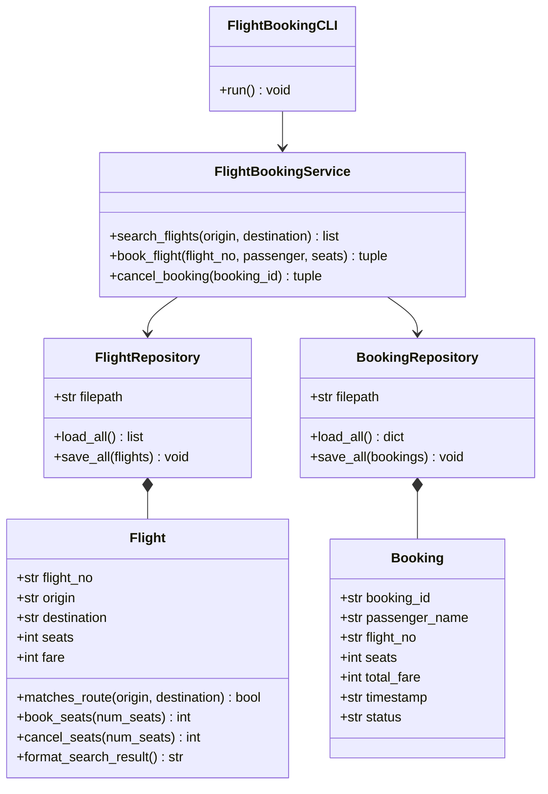
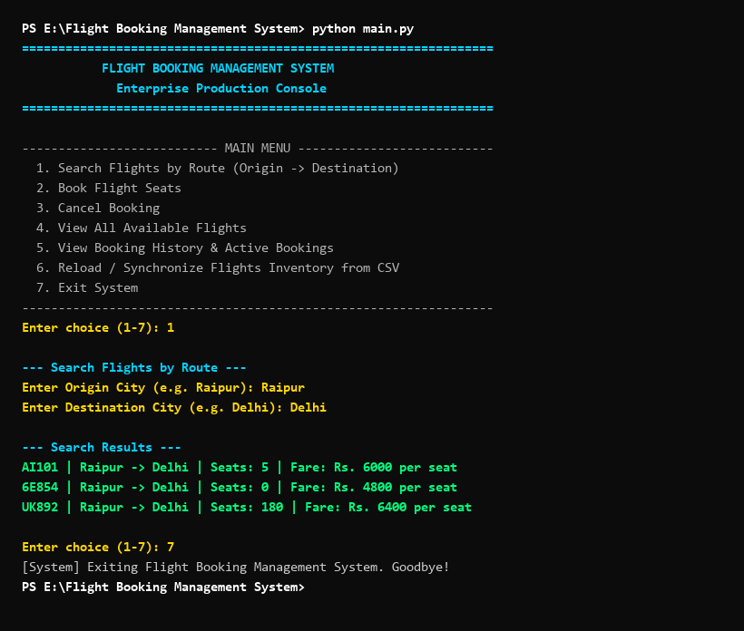
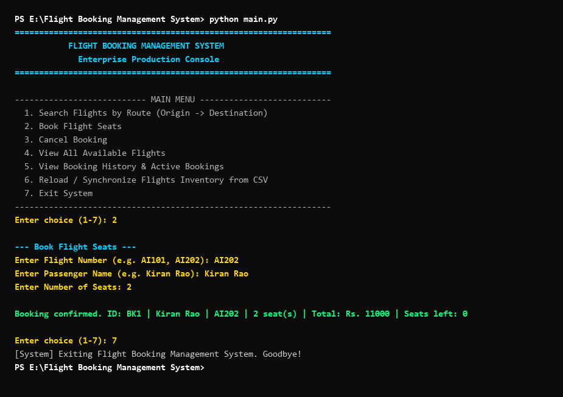
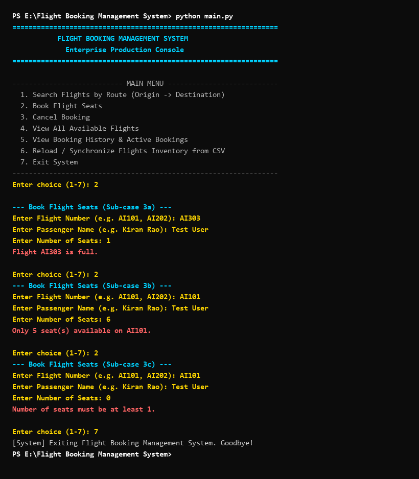
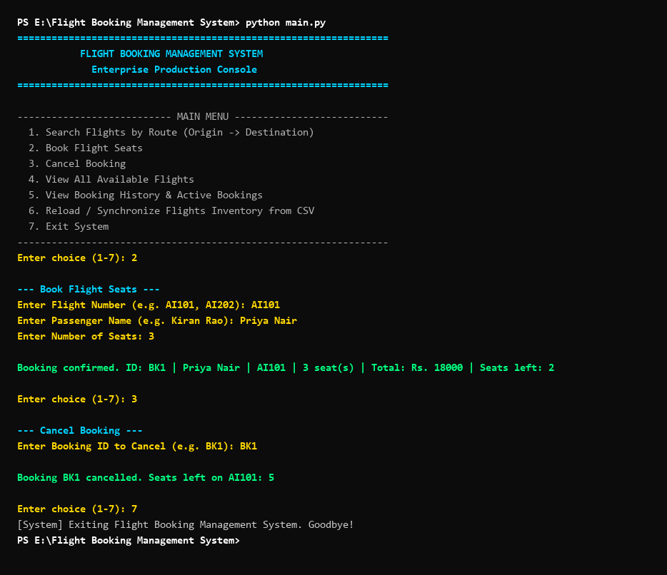

# Flight Booking Management System

Academic Implementation for Problem Statement No. 68  
**Student Name:** Sneha Sinha  
**University Roll No:** RU-26-01210  
**Section:** 1D  
**Course:** Programming Fundamentals and Logic Building Using Python  
**Institution:** Rungta International Skills University, School of Computer Science & Engineering  
**Degree Program:** B.Tech in Computer Science and Engineering  

---

## 1. Problem Statement

> "Build a flight booking program using a class Flight. Load flights from flights.csv, search by origin and destination, book seats (total = seats x fare) and cancel bookings. Seat counts must always stay correct."

### Core Requirements
1. Single executable Python 3 file (`main.py`) running from the console.
2. An OOP class `Flight` that encapsulates flight details along with methods to book and cancel seats.
3. Loading flight records from `flights.csv` into flight objects, with fallback handling if the file is missing.
4. Case-insensitive search by origin and destination.
5. Accurate fare calculation (`total = seats * fare`) and transactional updates so seat counts stay strictly consistent across bookings and cancellations.

---

## 2. Dataset (`flights.csv`)

The dataset contains 1,000 commercial flight schedules covering major domestic and international routes (Air India, IndiGo, SpiceJet, Vistara, Akasa Air, Emirates, British Airways, Qatar Airways, and Singapore Airlines).

### Structure
| Field | Data Type | Description | Example |
| :--- | :--- | :--- | :--- |
| `FlightNo` | String | Unique flight identifier | `AI101` |
| `Origin` | String | Departure city / airport | `Raipur` |
| `Destination` | String | Arrival city / airport | `Delhi` |
| `Seats` | Integer | Available seats for booking | `5` |
| `Fare` | Integer | Fare per seat in INR | `6000` |

Sample rows from `flights.csv`:
```csv
FlightNo,Origin,Destination,Seats,Fare
AI101,Raipur,Delhi,5,6000
AI202,Raipur,Mumbai,2,5500
AI303,Delhi,Mumbai,0,4800
6E854,Raipur,Delhi,0,4800
AI864,Delhi,Raipur,5,5000
UK892,Raipur,Delhi,180,6400
AI485,Udaipur,Chandigarh,22,5700
UK931,Thiruvananthapuram,Bhopal,32,3300
AI674,Dehradun,Delhi,8,7700
AI580,Tiruchirappalli,Port Blair,65,10800
```

---

## 3. Architecture and Class Design

The project uses a clean multi-layer design without any external dependencies. It relies exclusively on Python's standard library (`csv`, `os`, `sys`, `logging`, `datetime`).

### Component Breakdown
1. **`Flight` (Domain Entity)**:
   - Holds `flight_no`, `origin`, `destination`, `seats`, and `fare`.
   - `matches_route(origin, destination)`: Case-insensitive match on departure and arrival cities.
   - `book_seats(num_seats)`: Validates seat availability, subtracts seats, and returns total fare.
   - `cancel_seats(num_seats)`: Restores cancelled seats back to inventory.

2. **`Booking` (Domain Entity)**:
   - Tracks passenger reservations with unique booking ID, passenger name, flight number, reserved seats, total fare, ISO timestamp, and booking status (`CONFIRMED` or `CANCELLED`).

3. **`FlightRepository` & `BookingRepository` (Data Access Layer)**:
   - Reads records from and writes records to CSV files.
   - Uses atomic file writes (`os.replace`) to prevent file corruption if the program is closed mid-write.
   - Re-creates default starter records if `flights.csv` is accidentally deleted.

4. **`FlightBookingService` (Business Logic Layer)**:
   - Orchestrates search queries, seat reservations, cancellations, and state synchronization.
   - Enforces business rules: rejects zero or negative seat requests, flags full flights, and prevents overbooking.

5. **`FlightBookingCLI` (Presentation Layer)**:
   - Interactive console menu with input validation and tabular output pagination.



---

## 4. Test Scenarios and Output Verification

The application was tested against four core operational scenarios:

### Test Case 1: Route Search (Normal Query)
- **Input:** Origin = `Raipur`, Destination = `Delhi`
- **Expected Console Output:**
  ```text
  AI101 | Raipur -> Delhi | Seats: 5 | Fare: Rs. 6000 per seat
  ```
- **Result:** Pass



---

### Test Case 2: Boundary Booking (Seat Exhaustion)
- **Input:** Flight = `AI202`, Passenger = `Kiran Rao`, Seats = `2` (Available seats: 2, Fare: 5500)
- **Calculation:** $2 \times 5500 = 11000$ INR
- **Expected Console Output:**
  ```text
  Booking confirmed. ID: BK1 | Kiran Rao | AI202 | 2 seat(s) | Total: Rs. 11000 | Seats left: 0
  ```
- **Result:** Pass



---

### Test Case 3: Invalid Input and Capacity Rejections
- **3a. Booking on a full flight:** Requesting 1 seat on `AI303` (0 seats available).
  - Output: `Flight AI303 is full.`
- **3b. Overbooking:** Requesting 6 seats on `AI101` when only 5 are left.
  - Output: `Only 5 seat(s) available on AI101.`
- **3c. Zero or negative seat input:** Requesting 0 seats on `AI101`.
  - Output: `Number of seats must be at least 1.`
- **Result:** Pass



---

### Test Case 4: Booking Lifecycle and Cancellation
- **Step 1:** Book 3 seats on `AI101` for `Priya Nair`.
  - Output: `Booking confirmed. ID: BK1 | Priya Nair | AI101 | 3 seat(s) | Total: Rs. 18000 | Seats left: 2`
- **Step 2:** Cancel booking `BK1`.
  - Output: `Booking BK1 cancelled. Seats left on AI101: 5`
- **Inventory Check:** Seats restored from 2 back to 5.
- **Result:** Pass



---

## 5. Repository Structure

```text
.
|-- main.py                     # Main application code (OOP classes, CLI, persistence)
|-- flights.csv                 # 1,000 commercial flight database
|-- README.md                   # Project documentation and specifications
|-- summary.md                  # Academic submission summary report
|-- test_case_1_screenshot.png  # Test Case 1 terminal output snapshot
|-- test_case_2_screenshot.png  # Test Case 2 terminal output snapshot
|-- test_case_3_screenshot.png  # Test Case 3 terminal output snapshot
`-- test_case_4_screenshot.png  # Test Case 4 terminal output snapshot
```

*Note: Runtime files such as `bookings.csv` (persistent reservation ledger) and `flight_system.log` (audit trail) are created automatically when running the application.*

---

## 6. How to Run

### Requirements
- Python 3.8 or higher.
- No third-party packages needed (uses standard library only).

### Execution
Clone the repository and run `main.py`:
```bash
python main.py
```

### Menu Options
```text
--------------------------- MAIN MENU ---------------------------
  1. Search Flights by Route (Origin -> Destination)
  2. Book Flight Seats
  3. Cancel Booking
  4. View All Available Flights
  5. View Booking History & Active Bookings
  6. Reload / Synchronize Flights Inventory from CSV
  7. Exit System
-----------------------------------------------------------------
```
